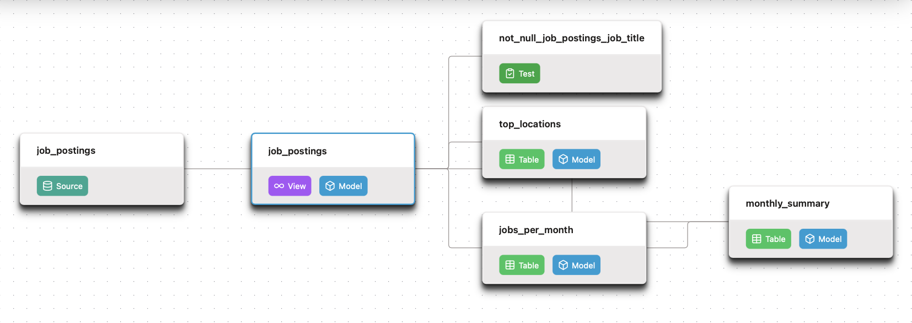

# Job Postings Analytics Pipeline — dbt + DuckDB

[](https://github.com/the-smashing-machine07/dbt-duckdb-pipeline/actions/workflows/dbt_build.yml)

An end-to-end analytics engineering pipeline that turns twelve months of raw, daily-scraped job postings into tested, documented, query-ready tables — built with dbt on DuckDB, and rebuilt from scratch by GitHub Actions on every push to `main`.

The whole warehouse is one portable file (`data/prod.duckdb`), so there is no server to provision and no credentials to manage. Clone, run three commands, and you have the same tables CI produces.

---

## 📌 What this is

A personal build of Project 1 from the dbt for Data Analytics & Engineering course. The dataset is real job postings, scraped daily, pulled from the course repository's `dataset-v1` release by `scripts/download_data.py`.

| | |
|---|---|
| **Transform layer** | dbt (declared sources → cleaned view → insight marts) |
| **Warehouse** | DuckDB, single-file, `data/prod.duckdb` |
| **Environment** | `uv`-managed, Python ≥ 3.12 |
| **Orchestration** | GitHub Actions — push to `main`, weekly schedule, manual dispatch |
| **Data quality** | dbt `not_null` / `unique` tests gating every build |

---

## 📁 Project layout

```
.
├── .github/workflows/dbt_build.yml   # CI: build, test, publish the warehouse
├── analytics/                        # the dbt project
│   ├── dbt_project.yml               # project config; default materialization: table
│   ├── README.md                     # placeholder
│   └── models/
│       ├── sources.yml               # declares the raw parquet source
│       ├── schema.yml                # model + column docs, data tests
│       ├── job_postings.sql          # view  — cleaned postings
│       ├── jobs_per_month.sql        # table — postings per role per month
│       ├── top_locations.sql         # table — top 10 locations
│       └── monthly_summary.sql       # table — monthly totals + % remote
├── ci/profiles.yml                   # prod DuckDB target used by Actions
├── scripts/download_data.py          # fetch raw parquet into data/raw/
├── src/dbt_duckdb_pipeline/          # package (currently just __init__.py)
├── pyproject.toml                    # uv-managed environment
└── uv.lock
```

`data/` is deliberately absent from the repo — the download script recreates it, locally and in CI.

---

## 📦 The data

`scripts/download_data.py` pulls thirteen parquet files (~85 MB) into `data/raw/`:

- `raw_job_postings_YYYY-MM.parquet` — twelve monthly files, `2025-07` through `2026-06`
- `raw_job_skills.parquet` — the associated skills table

Each posting row carries the scraped fields the models rely on: `job_id`, `job_title`, `company_name`, `job_location`, `job_via`, `job_schedule_type`, `job_work_from_home`, `search_date` (the scrape day) and `search_term` (the role the scraper searched for).

The source is declared once in `models/sources.yml` as a glob, so no model ever hardcodes a file path:

```yaml
sources:
  - name: raw
    tables:
      - name: job_postings
        config:
          external_location: '../data/raw/raw_job_postings_*.parquet'
```

---

## ⚙️ The pipeline

Raw postings flow through three dbt layers — declared source → cleaned view → insight marts — with tests gating every build:



| Model | Materialization | Grain | Question it answers |
|---|---|---|---|
| `job_postings` | view | one row per scraped posting | Which postings are clean enough to analyse? (`error is NULL`) |
| `jobs_per_month` | table | month × role | How many postings per role, each month? |
| `top_locations` | table | location | Where are the most postings? (top 10) |
| `monthly_summary` | table | month | What share of each month's postings are remote? |

`monthly_summary` is the payoff model: it sums monthly totals from `jobs_per_month`, counts remote postings from `job_postings`, and joins the two on `month` to produce `total_postings`, `remote_postings` and `pct_remote`.

And the dbt features doing the work:

| dbt feature | How it's used | Where to look |
|---|---|---|
| Declared sources | Parquet glob declared once; models call `source('raw', 'job_postings')` — no hardcoded paths in SQL | `models/sources.yml` |
| `ref()` for dependencies | Downstream models build on `job_postings`; `monthly_summary` joins two refs. dbt resolves order and parallelism | `models/*.sql` |
| Materializations | Project default `table`; `job_postings` overridden to `view` | `dbt_project.yml`, `job_postings.sql` |
| Data tests | `not_null` on `job_title`; `not_null` + `unique` on `monthly_summary.month` | `models/schema.yml` |
| Persisted docs | `persist_docs` writes model and column descriptions into the warehouse metadata, so they travel with the file | `models/schema.yml` |
| Environments | Local dev vs CI `prod` target writing `data/prod.duckdb` | `ci/profiles.yml` |

`dbt build` compiles the SQL, materializes the models and runs the tests — and fails the run if any test fails. Same command locally and in CI.

---

## ✅ Data quality

Tests live beside the models in `models/schema.yml`, not in a separate suite, so a broken assumption fails the build that introduced it:

- `job_postings.job_title` — `not_null`
- `monthly_summary.month` — `not_null` and `unique`

Every model and column carries a description, including the caveats worth knowing: `job_id` repeats across re-scrapes, `job_title` is blank on the scraper's error rows, and roughly 2,472 upstream rows have a null location — which the top-10 cut in `top_locations` keeps out of the output.

---

## 🚀 Production

GitHub Actions runs the whole pipeline — no laptop required. `.github/workflows/dbt_build.yml` triggers on:

- every push to `main`
- a weekly schedule (Mondays, 06:17 UTC)
- manual dispatch via the **Run workflow** button

Each run checks out the repo, installs `uv`, syncs dependencies, downloads the raw data, then executes `dbt build` against the `prod` target. On success it attaches the resulting `data/prod.duckdb` to a GitHub Release tagged `warehouse`, overwriting the previous asset — so the latest build is always downloadable straight from the Releases page.

```yaml
- run: uv run python scripts/download_data.py
- run: uv run dbt build --profiles-dir ../ci
  working-directory: analytics
```

Because the tests run inside `dbt build`, a failing test stops the run before a bad warehouse gets published.

---

## 📖 Docs

Docs are generated with `dbt docs generate` and published to GitHub Pages:

**→ [Link to dbt docs](https://the-smashing-machine07.github.io/dbt-duckdb-pipeline/)**

The site shows:

- The full **lineage graph** (sources → models → marts)
- **Model and column descriptions** from the YAML
- Which columns carry **tests**

---

## 💻 Run it yourself

```bash
# 1. install dependencies (uv reads pyproject.toml + uv.lock)
uv sync

# 2. fetch the raw data — run from the REPO ROOT, not from inside scripts/
uv run python scripts/download_data.py

# 3. build and test the warehouse
cd analytics
uv run dbt build --profiles-dir ../ci
```

Two things worth knowing:

- **Step 2 resolves `data/raw/` relative to your current directory.** Run it from the repo root or the files land somewhere unexpected. Re-running is safe — files you already have are skipped.
- **`--profiles-dir ../ci` uses the same `prod` target as CI**, writing `data/prod.duckdb`. If you'd rather keep a separate local target, drop your own `profiles.yml` in `~/.dbt/` defining an `analytics` profile with a `dev` output.

Once built, the warehouse is a single file:

```bash
duckdb data/prod.duckdb
# or point any DuckDB client at it
```

---